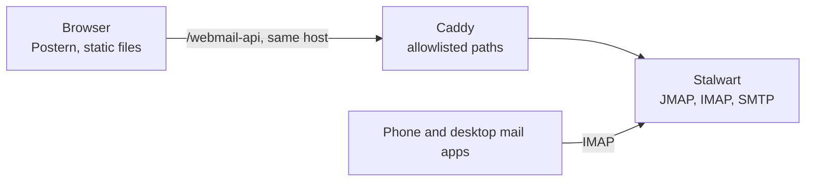

# Postern

A webmail for the owner's own domain that looks and works like Gmail, talking JMAP straight to the estate's Stalwart mail server. It is for the owner and anyone given a mailbox on that domain.



**Status:** Built and not deployed yet, and checked against a local Stalwart, with 1,291 unit and integration tests and a 46-test browser suite. The deploy is prepared in the estate's deploy tool and waits for the owner. A postern is the small side gate in a castle wall.

## What it does

- Shows mail as conversations with labels, a search box that understands `from:` and `has:attachment`, keyboard shortcuts and live updates. A setting turns conversation view off, one row per message.
- Writes mail in a floating composer, with send later, which Stalwart holds until its time, and snooze, which brings a conversation back to the inbox when its time comes and Postern is open.
- Shows a calendar invite as a card you can answer.
- Renders untrusted mail safely: sanitised HTML in a sandboxed frame with its own content security policy, remote images blocked until you ask.
- Signs in through Stalwart's own accounts and keeps the session across a reload.

There is no backend of its own: Stalwart parses the mail, threads it, runs the search and pushes changes. Phones and desktop mail apps keep using IMAP; Postern is one more way in, not a replacement. It has no chat, no meeting links and no smart compose, and it uses its own look rather than Google's.

## How it works

Three parts. `jmap/` is a typed JMAP client with no React. `web/` is the React app, built by Vite into static files. `dev/` runs a local Stalwart with test accounts and seeded mail. In production the browser loads the app from the root of `postern.<domain>`, and Caddy forwards `/webmail-api` on the same host to Stalwart, so there is no cross-origin request.


The diagram at the top is the request path. More in the wiki's [architecture page](corpus/wiki/architecture.md) and [security page](corpus/wiki/security.md).

## Run it locally

Requires Node 24 and Docker for the local Stalwart. Never point it at a real mailbox.

```bash
npm ci
npm run dev:mail     # a local Stalwart with two test accounts on postern.test
npm run dev:seed     # fill them with ordinary and hostile test mail
npm run dev          # the app on http://localhost:5173, proxying /webmail-api to Stalwart
npm run check        # typecheck, lint, unit and integration tests
```

The test accounts' passwords are in the git-ignored `dev/.env` that `dev:mail` writes. More, including the browser suite: [docs/getting-started.md](docs/getting-started.md) and [dev/README.md](dev/README.md).

## Deploy

Postern ships through the estate's deploy tool, `vps-deploy`. Its stack runs `npm ci` and `npm run build` here, then uploads `web/dist`, served at the root of `postern.<domain>` with the headers in [corpus/wiki/security-headers.md](corpus/wiki/security-headers.md). The owner runs the deploy; the steps and the smoke test are in [corpus/wiki/status.md](corpus/wiki/status.md), under Owner steps.

## Project layout

| Path | What lives there |
|---|---|
| `jmap/` | `@postern/jmap`: the typed JMAP client, tested against a real Stalwart |
| `web/` | `@postern/web`: the React app, and `web/e2e/` the browser suite behind Caddy |
| `dev/` | The local Stalwart: compose file, plan, accounts and the seed mail |
| `corpus/` | The project wiki: decisions, design, security, status and the briefs |

## Docs

- [docs/](docs/README.md): setup and the checks; screenshots are still to come
- Project wiki: [corpus/](corpus/index.md), starting with [overview.md](corpus/wiki/overview.md)

## License

No license yet; all rights reserved.
