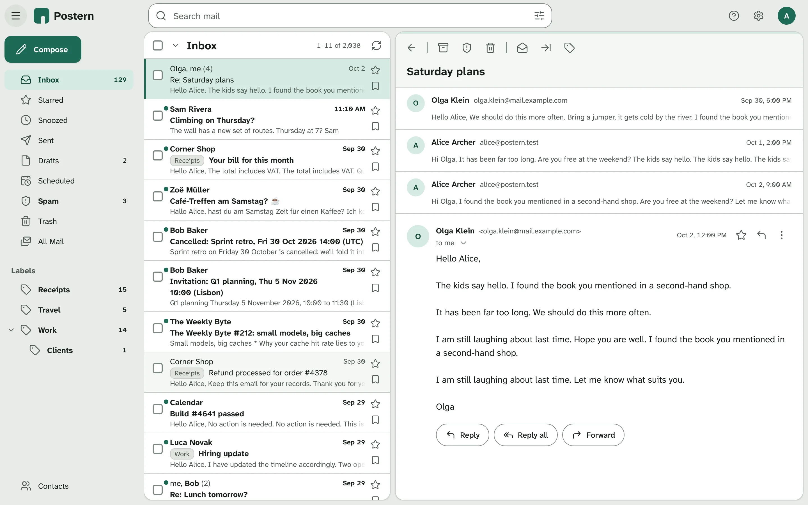
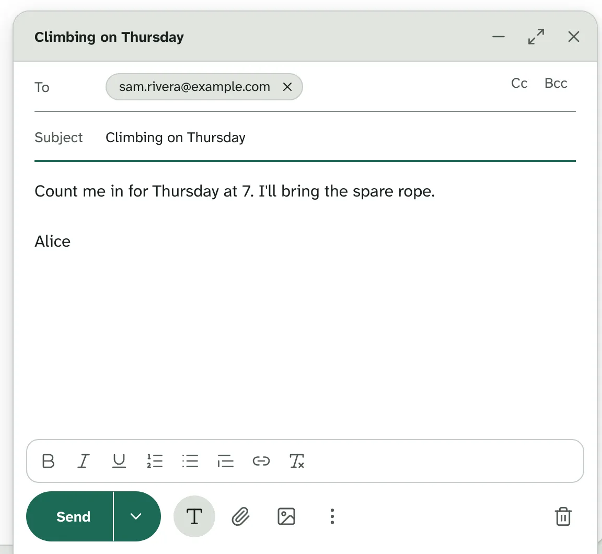
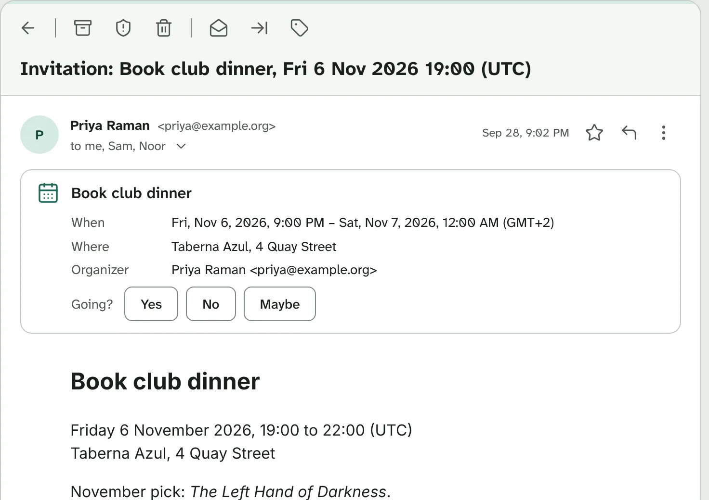
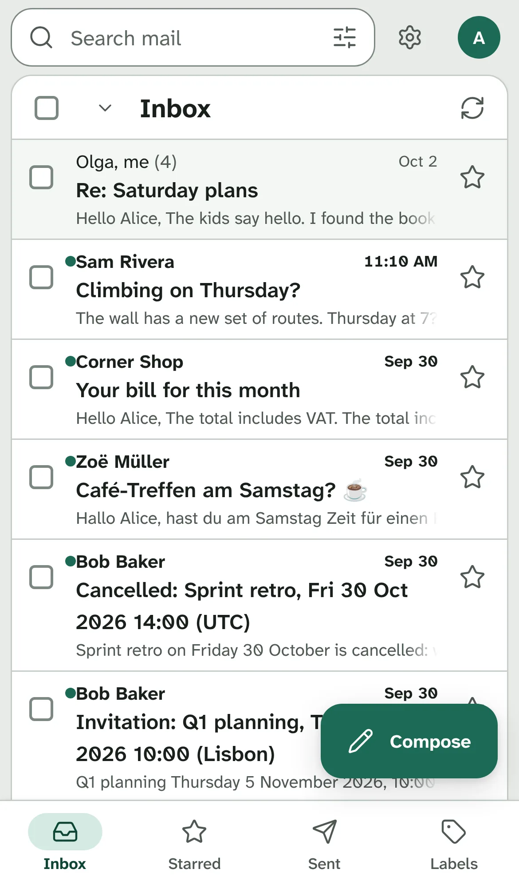
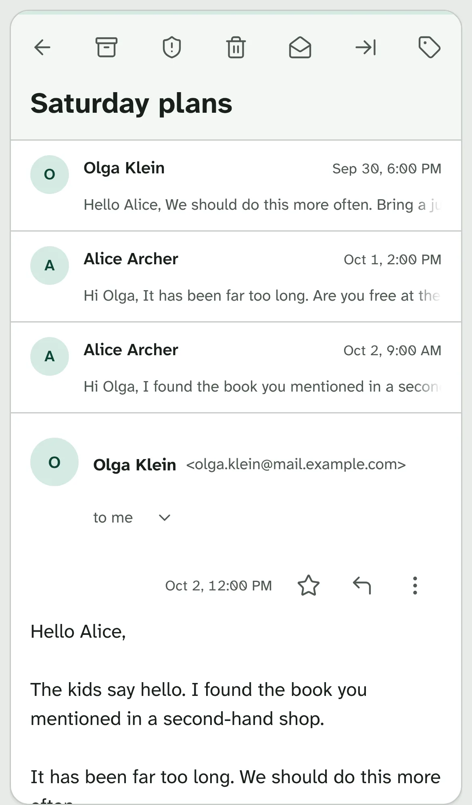
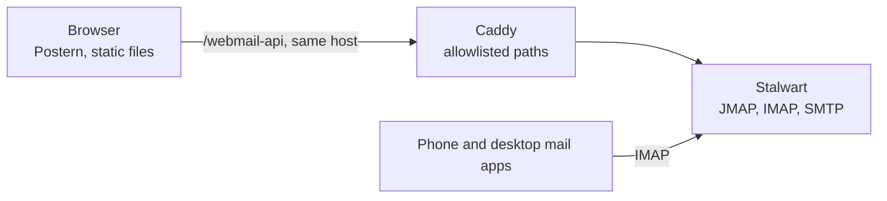

# Postern

A webmail for the owner's own domain that looks and works like Gmail, talking JMAP straight to the estate's Stalwart mail server. It is for the owner and anyone given a mailbox on that domain.

<p align="center">
  
</p>

**Status:** Personal project, live at the root of its own host, `postern.<domain>`, since 2026-11-02; the owner's smoke test passed on 2026-11-05. The redesign in these pictures, "The reading desk" (2026-11-13), is on `main` and waits for the owner's next deploy. It has 1,321 unit and integration tests, a 54-test browser suite against a local Stalwart, and 73 browser checks that need no mail server. A postern is the small side gate in a castle wall.

## What it does

- Shows mail as conversations with labels, a search box that understands `from:` and `has:attachment`, keyboard shortcuts and live updates. The reading pane sits beside the list; a setting turns conversation view off, one row per message.
- Writes mail in a floating composer, with send later, which Stalwart holds until its time, and snooze, which brings a conversation back to the inbox when its time comes and Postern is open.
- Shows a calendar invite as a card you can answer Yes, No or Maybe.
- Renders untrusted mail safely: sanitised HTML in a sandboxed frame with its own content security policy, remote images blocked until you ask.
- Installs as an app on a phone, with a bottom bar and push notifications for new mail. It signs in with Stalwart's own accounts and keeps the session across a reload; closing the tab ends it.

Postern has no backend of its own. Stalwart parses the mail, threads it, runs the search and pushes changes. Phones and desktop mail apps keep using IMAP; Postern is one more way in, not a replacement. It has no chat, no meeting links and no smart compose, and it uses its own look rather than Google's.

## Screenshots

| The composer window | A calendar invite, answered from its card |
|---|---|
|  |  |
| **The Inbox on a phone, with the bottom bar** | **A conversation on a phone** |
|  |  |

All of them show the test mailbox from `dev/seed/`, with made-up people. How each was taken: [docs/images/shots.md](docs/images/shots.md).

## How it works

Three parts. `jmap/` is a typed JMAP client with no React. `web/` is the React app, built by Vite into static files. `dev/` runs a local Stalwart with test accounts and seeded mail. In production the browser loads the app from the root of `postern.<domain>`, and Caddy forwards `/webmail-api` on the same host to Stalwart, so there is no cross-origin request.



More in the wiki's [architecture page](corpus/wiki/architecture.md) and [security page](corpus/wiki/security.md).

## Run it locally

Requires Node 24 and Docker for the local Stalwart. Never point it at a real mailbox.

```bash
npm ci
npm run dev:mail     # a local Stalwart with two test accounts on postern.test
npm run dev:seed     # fill them with ordinary and hostile test mail
npm run dev          # the app on http://localhost:5173, proxying /webmail-api to Stalwart
npm run check        # typecheck, lint, format, conventions, contrast and tests
```

The test accounts' passwords are in the git-ignored `dev/.env` that `dev:mail` writes. Without the local Stalwart the integration tests skip, so a green `check` is not the whole gate. The full setup, the browser suites and the checks that run without Docker are in [docs/getting-started.md](docs/getting-started.md) and [dev/README.md](dev/README.md).

## Project layout

| Path | What lives there |
|---|---|
| `jmap/` | `@postern/jmap`: the typed JMAP client, tested against a real Stalwart |
| `web/` | `@postern/web`: the React app; `web/e2e/` the browser suite behind Caddy, `web/e2e/desk/` the checks on a stub of the mail API |
| `dev/` | The local Stalwart: compose file, plan, accounts and the seed mail |
| `scripts/` | The contrast check and `check:fast` |
| `docs/` | Setup, deploy and the images in this README |
| `corpus/` | The project wiki: decisions, design, security, status and the briefs |

## Docs

- [docs/](docs/README.md): setup, the checks, the deploy and how the screenshots were taken
- Project wiki: [corpus/](corpus/index.md), starting with [overview.md](corpus/wiki/overview.md) and [status.md](corpus/wiki/status.md)

## License

No license yet; all rights reserved.
